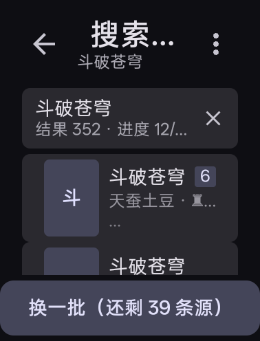
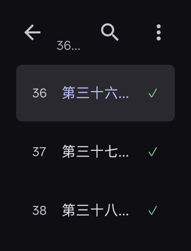

# 手表端小说下载器

在 Android 手表上搜书、下载、直接读。方屏适配，不经手机，没有服务端，书源兼容 legado。

vibecoding 项目，代码主要由 AI 写。

<p align="center">
  
  
  
  
</p>
<p align="center"><sub>书架 · 搜索 · 目录 · 阅读（手表实机截图）</sub></p>

## 操作

主界面四栏：书架 / 收藏 / 发现 / 我的。收藏独立于已下载书架，
可从搜索结果或详情加入，不以下载作业是否存在作为收藏条件。

阅读页翻页不靠左右滑，靠点按，按纵向三段划分：

| 操作 | 效果 |
|---|---|
| 点正文上三分之一 | 上一屏 |
| 点正文下三分之一 | 下一屏 |
| 点中间三分之一 | 开关菜单 |
| 转表冠 | 滚动正文，每格 12 px，50 ms 跟手 |
| 长按书架卡片 / 目录章行 / 搜索结果 | 弹该行的操作菜单 |

不按横向分三列。三列各 63 dp，比一个触摸目标还窄，横着切只会误触。

菜单分两层：顶栏三枚动作（刷新 / 换源 / ⋮），底栏一排工具格（默认
查找、自动翻页、目录、设置，可换成换源、缓存、书签、更多），
下面是上一章 / 全书进度条 / 下一章和亮度行。⋮ 打开的「更多操作」里还有
离线缓存、章内查找、加书签、阅读设置、阅读记录、导出 TXT。

## 适配设备

按 OPPO Watch 3 Pro 实测尺寸设计：物理 378 × 496 px @ 326 ppi →
density 2.0（320 dpi）→ 逻辑 **189 × 248 dp**。

运行时按 `screenWidthDp` 分两档：≥ 320 走手机档，否则走手表档。
手表档的顶栏 25 dp、底栏 64 dp、页签 40 dp、底栏指示点 8 dp，
都比 MD3 标准值收窄——248 dp 的屏高，标准尺寸会吃掉一多半。

正文默认 16 sp，可在阅读设置里调到 10–24 sp。

## 安装

```sh
adb install -r releases/v1.6.1.1/WatchDownloader-1.6.1.1-release.apk
```

也可以把 APK 传进手表后用文件管理器点开。minSdk 30（Android 11），targetSdk 34。

## 功能

- **书架与收藏**：书架列已下载的书，收藏单独列出保留的书籍。
  下载、阅读与收藏状态独立保存，移除收藏不删除已下载内容。
- **搜索**：多书源并发，结果带上来源数与「结果 N · 进度 x/y」，
  底栏「换一批（还剩 N 条源）」轮下一批。结果窗口 60 条。
- **下载**：跑在前台服务里，锁屏不断。进度屏给章数、失败数、章/分、预估剩余，
  可取消或回目录。
- **导出**：`书名 - 作者.txt`，UTF-8 带 BOM，重名自动加 `(2)`。
  优先落系统「文档」目录，失败退回应用私有 `files/export/`。
- **阅读器**：日 / 夜底色、亮度、字号、行距、段距、缩进、字距、字重、斜体、
  两端对齐、标题位置与字号、三档边距、滚一屏 / 覆盖两种翻页动画与时长、
  常亮、1–60 秒自动翻页、恢复默认排版。
- **我的**：书源管理、替换净化、设置、书签、阅读记录、缓存管理、
  文件管理、日志、关于。设置里还有配色、表冠每格位移与跟手时长。

## 书源

当前 v1.6.1.1（code 42）沿用 17 条内置书源。以下为 v1.6.1 的抽检记录，本版未重新在线抽检。原 16 条中 15 条通过本轮抽检，
飞卢一条目录截断，状态未定并保留。新增搬山人小说网通过两轮独立抽检。
当前结果只覆盖抽检时段与样本，
不代表所有作品、全部章节或后续访问始终可用。
书源可在“我的 → 书源管理”中管理，在线状态以实际访问结果为准。

### v1.5.2 历史抽检记录

以下保留远端基线的历史说明，不作为本版 17 条源的统计口径：

> 本版内置书源共 38 条。现有 56 条与墨辰 7.5 合集 463 条合并后，
> 395 条具备必要规则的文字源接受在线检查，43 条通过，按地址去重后保留 38 条。
> 检查包括搜索、非截断目录和前中后三章正文抽检。每章至少 300 个汉字，
> 且三章正文不重复、不含明显错误页。网络失败项复测仍未通过则不收录。
> 通过仅代表本次抽检，不代表全部作品、章节或后续时段始终可用。
> 书源可在“我的 → 书源管理”中管理，在线状态以实际访问结果为准。

## v1.6.1.1 修复说明（code 42）

- 收藏按书名和作者识别，同地址不同书独立保存，搜索操作后更新标记。
- 目录、正文和下载页增加收藏入口，移出收藏保留历史和缓存。
- 在线阅读独立保存目录快照，无收藏、无下载也可从记录恢复。
- 阅读身份贯穿历史、进度、偏移与页面恢复，避免同地址不同书串书。
- 修正正文阅读记录入口，离开正文解除会话，避免删除历史后写回。
- 缓存目录采用完整摘要，迁移旧目录时核对身份。
- 更新检查兼容三段与四段版本。1.6.1旧版不识别四段标签，需从发布页下载本版。
- 38组回归、界面编译与正式包校验通过；未安装、未执行设备界面测试。
- 暂时仅出现番茄的现象已由用户确认恢复，本版没有据此修改书源。

## v1.6.1 修复说明（code 41）

- **目录**：分页共享脚本库，按每页地址解析链接，明确报告截断。
  试源抽样跳过公告，并保留网络超时的未定状态。
- **收藏与换源**：兼容旧收藏，多来源候选按书名与作者匹配。
  候选目录验证通过后才迁移进度，失败重试保留原书上下文。
- **发现**：番茄榜单直接读取包内 UTF-16 字符表。
  起点男频全站月票榜接入真实分页，匿名令牌只保存在内存。
  月份取自官网元数据，失败不推进页码。其他榜单仍只展示首批。
- **输入**：表冠合并逐帧滚动任务，避免快速输入累积延迟。
- **关于**：项目地址指向正式仓库，用户点击后检查 GitHub 正式版本。
- **验证边界**：离线回归、在线抽检与正式包校验分别记录在发布说明。
  本轮未安装、未执行真机界面测试。

## v1.6.0 整合说明（code 40）

- **基线**：接入远端 `a7a696418b2fbc01e1a2f9274b18a940ff712d50`，
  保留本地源码、测试及书源整合改动。
- **界面**：四栏导航与独立收藏，统一配色、返回入口及下载进度入口。
- **榜单**：配置升至第 4 版，起点使用官网九榜，未确认的分页能力不开放。
  分类与周期筛选仅有 4 次在线抽检证据。女频入口已接入，未验证可用性。
- **阅读**：修复分页边界、末页与跨章翻页衔接，保留分页回归测试。
- **兼容边界**：脚本语法兼容仍有限，不等同于完整现代 JavaScript 或 Legado 宿主。
- **验证状态**：33 组回归测试通过，另有 1 组语法诊断，合计 34 组运行退出码为 0。
  语法诊断支持 16/22 项，不支持箭头默认参数、对象解构默认值、调用展开、
  数组展开、class、async。此结果不代表全部语法兼容。
- **构建检查**：核心与界面编译、ZIP CRC、4 字节对齐、正式签名及 dex 校验通过。
  本版 APK 为 1783416 字节，SHA256 为
  `b473ec0f76350f7ead73a51c4469c306a789ebf461250aa994d46a6966fd22e5`。
- **设备边界**：本次整合未安装、未真机验证。页面顶部图片为历史版本截图。
  源筛选、离线回归与设备验证分别记录，在线抽检不扩大为全量保证。

## 代码结构

`src/com/watchdl/core/` —— 纯 Kotlin，不依赖 Android API，可单独跑自检：

| 文件 | 作用 |
|---|---|
| `CharsetFontDecoder` | 番茄正文的字体混淆还原（照抄 `fanqie-booksource` 方案） |
| `TinyJson` | 极简 JSON 路径取值、对象列表、正文抽取、转义还原 |
| `Rule` / `Template` | 书源规则模型与 URL 模板求值（只支持 `{{变量}}` 与四则运算） |
| `JobStore` | 双写状态：`job.json` 原子快照 + `chapters.jsonl` 逐章追加 |
| `BatchPlan` / `Backoff` | 分批、缩批、退避策略（照抄 TND） |
| `Downloader` | 串行下载引擎，支持续传、只重跑失败章、导出 TXT |
| `ReaderStyle` | 阅读排版的全部取值与范围 |
| `BookJob` / `ChapterRef` | 作业与章节状态 |

Android 层按屏分包在 `src/com/watchdl/ui/`：`shelf` / `search` / `book` /
`reader` / `source` / `my`，加公共的 `theme` 与 `Tabs`。`MainActivity.kt`
管导航栈与返回位置。

设计稿与可点原型在 `ui/`：`prototype.html`（含下载进度模拟）、
`md3-final.html`（8 屏 + 尺寸对照尺）、`density-compare.html`。
图标用 `python3 tools/make_icon.py` 重新生成。

## 构建

不用 Gradle/AGP：本机是 Termux，`aapt2` / `d8` / `apksigner` 都是独立命令，
整条链路无 Maven 下载。

```sh
bash build.sh test   # 跑纯 JVM 自检（不打包）
bash build.sh        # 打出 build/WatchDownloader-<版本>-release.apk
```

脚本必须用 `bash build.sh` 调，不能 `./build.sh` —— 本机没有 `/bin/bash`。

依赖：`pkg install kotlin`、JDK 21、`~/android-sdk`（platforms/android-34 + build-tools）。

### 签名

正式签名信息在 `release.keystore` 与 `keystore-info.txt`（**自行备份**，
丢了就没法发升级版）。两个文件都在时自动用正式签名；缺任何一个则退回
debug 签名，流水线仍可用。

### 版本号

每次改动都要升版本号，不能只在发包时升。

| 变量 | 规则 |
|---|---|
| `APP_VERSION` | 主版本.次版本.修订，功能改动升次版本，修 bug 升修订 |
| `APP_VERSION_CODE` | 整数，只增不减，每版 +1 |

```sh
# 改 build.sh 第 23-24 行的默认值即可；临时覆盖用环境变量：
APP_VERSION=1.0.1 APP_VERSION_CODE=2 bash build.sh
```

`versionCode` 不升的后果（Android 平台行为，本项目未实测）：同版本号覆盖安装
会被拒，装新包报 `INSTALL_FAILED_VERSION_DOWNGRADE`。

## 协议要点

三条链路无签名、无 Cookie、无服务端：

| 环节 | 接口 |
|---|---|
| 搜索 | `novel.snssdk.com/api/novel/channel/homepage/search/search/v1/?device_platform=android&parent_enterfrom=novel_channel_search.tab.&offset=&aid=1967&q=` |
| 目录 | `fanqienovel.com/api/reader/directory/detail?bookId=` |
| 正文 | `fanqienovel.com/reader/{item_id}` + `charset.json` 查表还原 |

### 踩过的坑

都是实测，别再踩：

1. **书名字段是 `title`，不是 `book_name`。** 搜索接口不返回 `book_name`。
2. **目录接口只返回两个键**：`allItemIds`（章节顺序）和
   `chapterListWithVolume`（分卷嵌套）。没有书名和作者，书名要从搜索结果传入。
3. **`chapterListWithVolume` 是 `[[{}],[{}]]` 双层嵌套。** 按下标拍平会与
   `allItemIds` 错位（实测 2500 章只抽出 75 章）。必须按 `itemId` 建映射连接。
4. **付费章返回 HTTP 404**，不是 IP 被封。`isChapterLock == true` 的章一律取不到，
   下载时直接跳过并标 `LOCKED`，不要浪费请求。
5. **免费章数量会变。** 同一本书（《绝世武神》）早先查是 2435 章免费，
   后来只有 10 章。这是番茄自己的策略，不是缓存问题，每次下载前重新拉目录。
6. **不要用回溯正则抽正文。** `"content":"((?:[^"\\]|\\.)*)"` 在 20 KB 以上的
   正文上会抛 `StackOverflowError`（手表上栈更小）。用 `TinyJson.extractContent`
   的线性扫描。
7. **`fanqienovel.com/reader/{id}` 需要正常章节 id。** 拿"深度解读""某某归来"
   这类条目去取正文容易撞 404，按 `isChapterLock` 过滤后再取。
8. **`charset.json` 是 UTF-16 编码**，读的时候要指定字符集。表有两行，区间重叠
   （58344 / 58345 起），消歧靠"按 mode 0 先试 + 表项非 `?`"。

## 待办

- [ ] `nextContentUrl` 分页（部分书源正文分页，现在只取第一页）
- [ ] EPUB 流式导出（现在只有 TXT）

## 协议与参考

本项目以 GNU GPL v3.0 发布，全文见 `LICENSE` 或
<https://www.gnu.org/licenses/gpl-3.0.txt>。使用、修改、再分发需保留版权与许可声明，
衍生作品同样以 GPL-3.0 发布，不提供担保。

书源由使用者自行添加，正文内容与版权归原作者及原站点，请勿转载或商业分发。
数据只写在应用私有目录，卸载即删。

下列项目只借鉴方案与结构，未复制其源码：

| 项目 | 借鉴内容 |
|---|---|
| `LegadoTeam/legado` | JsEngine 宿主 API 面、书源规则字段定义、按屏分包的目录结构 |
| `hapelee/legado-with-MD3` | MD3 尺寸阶与主题取值的思路 |
| `Zennmn/legado` | 同品牌手表的顶栏 + 内容列 + 底栏三段式布局 |
| `fanqie-booksource` | 番茄正文字体混淆还原方案与 `charset.json` 字符表 |
| TND | 分批、缩批、退避的下载策略 |

第三方组件：脚本引擎 Rhino（MPL 2.0），其余依赖各自保留原许可。
